  

  
  
  

  
  
  

---

## 👨‍💻 About Me

- 🎓 CSE student at **International Islamic University Chittagong (IIUC)**
- 🚀 Founder of **Bookeeds**, a student productivity and book exchange platform
- 🌱 Currently learning **⚛️ React.js · ▲ Next.js · 🍃 MongoDB**
- 🛠️ Building full-stack and AI-assisted projects
- 💬 Passionate about real-world projects and modern web technologies like React, Next.js and TypeScript
- 📫 Reach me at **25afridfoisal00@gmail.com**
- 🌐 All my projects: [md-afrid-foisal-opu.xyz](https://md-afrid-foisal-opu.xyz/)

---

## 🛠️ Languages & Tools

  
  
  
  
  
  
  
  
  
  
  
  
  
  
  
  
  

---

## 🚀 Featured Projects

| Logo | Project | Description | Live Demo |
| :---: | :--- | :--- | :---: |
|  | **Bookeeds** 🌟 | My startup project — a student-friendly platform focused on learning, productivity, and academic collaboration. | [🌐 Visit](https://bookofdeeds.great-site.net/) |
|  | **Heaven Furniture** 🏆 | A furniture website developed as a hackathon project, featuring a responsive shopping experience. | [🚀 Live Demo](https://heaven-furniture-hh2jv898q-afrids-projects-58b8b185.vercel.app/) |
|  | **OurShop — E-commerce** 🛒 | An e-commerce platform featuring product listings, shopping cart, and checkout functionality. | [🛍️ Shop Now](https://ourshop-flax.vercel.app/) |
|  | **BazarDor — Market Price Tracker** 📊 | A Bangladesh-focused daily market price tracking platform featuring essential product prices, categories, price comparisons, and market trends. | [📈 Live Demo](https://bazar-dor-goem.vercel.app/) |
|  | **Personal Portfolio** 💻 | My personal developer portfolio showcasing projects, technical skills, and experience. | [🌐 Visit](https://md-afrid-foisal-opu.xyz/) |

---

## 📊 GitHub Stats

  

---

## 📈 Contribution Activity

  <picture>
    <source media="(prefers-color-scheme: dark)" srcset="https://raw.githubusercontent.com/Afrid25/Afrid25/output/github-snake-dark.svg" />
    <source media="(prefers-color-scheme: light)" srcset="https://raw.githubusercontent.com/Afrid25/Afrid25/output/github-snake.svg" />
    
  </picture>

## 🤝 Connect With Me

  
  
  
  
  
  
  

  

